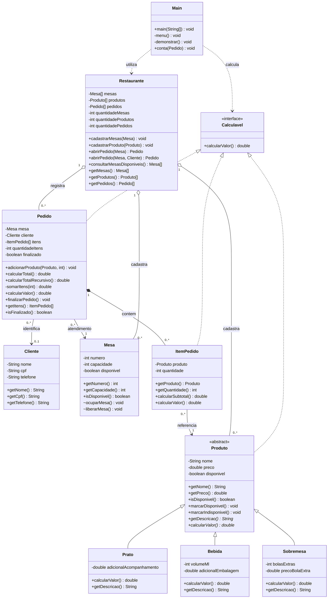

# Sistema de Restaurante - Unidade II

Evolução do [projeto da Unidade I](https://github.com/Joaoifbavamo/SistemaRestauranteJava), com **Java 20**, console interativo e arrays nativos. Sem `ArrayList`, banco de dados ou bibliotecas externas.

## Grupo B

- Marlon Santos Carvalho
- João Vitor Gonçalves de Jesus
- Marco Antônio Chaves De Souza
- Gabriel Ribeiro Guimaraes

## Executar

Instale o **JDK 20** e confirme `java -version` e `javac -version`. No Windows, se necessário, defina `$env:JAVA_HOME = 'C:\Program Files\Java\jdk-20'`.

Na raiz do projeto, em PowerShell:

```powershell
.\executar.ps1          # menu interativo, inicia com cadastros vazios
.\executar.ps1 -Demo    # demonstracao completa com dados ficticios
.\executar.ps1 -Testar  # verificacoes automaticas
```

Se a política local bloquear scripts, compile manualmente sem alterar a política:

```powershell
New-Item -ItemType Directory -Force build
$fontes = Get-ChildItem src,test -Recurse -Filter '*.java' | ForEach-Object FullName
javac --release 20 -encoding UTF-8 -Xlint:all -d build $fontes
java -cp build restaurante.app.Main
java -cp build restaurante.app.Main --demo
java -cp build restaurante.Testes
```

Linux/macOS com JDK 20: `sh executar.sh`, `sh executar.sh --demo` ou `sh executar.sh --testar`.

## Funcionalidades

Cadastro de mesas e produtos; disponibilidade do cardápio; cliente opcional; abertura de pedidos; inclusão de itens e quantidades; conta iterativa e recursiva; finalização e liberação de mesa; consulta de mesas livres. O menu permite experimentar essas operações e apresenta mensagens para entradas inválidas.

## Requisitos da Unidade II

| Requisito | Implementação |
|---|---|
| Classe abstrata e herança | `Produto` → `Prato`, `Bebida`, `Sobremesa` |
| Particularidades | Acompanhamento do prato, embalagem da bebida, bolas extras da sobremesa |
| Interface | `Calculavel`, implementada por `Produto`, `ItemPedido` e `Pedido` |
| Polimorfismo real | `ItemPedido.calcularValor()` chama `produto.calcularValor()` usando uma referência `Produto` |
| Pedido misto | Um `ItemPedido[]` armazena itens das três categorias |
| Recursão real | `Pedido.calcularValor()` utiliza `somarItens(0)` na conta exibida |
| Pacotes | `contrato`, `modelo`, `servico`, `app` |
| UML atualizado | [Diagrama e fonte editável](docs/DIAGRAMA.md) |
| Documento breve | [Documentação](docs/DOCUMENTACAO.md) |
| Evolução da Unidade I | [Rastreabilidade](docs/EVOLUCAO.md) e fontes originais em `docs/unidade-I/` |

`Produto` é abstrata porque reúne nome, preço e disponibilidade, mas cada categoria define seu próprio `calcularValor()` e `getDescricao()`. `Prato`, `Bebida` e `Sobremesa` usam `extends Produto`. `Calculavel` define um único método: `double calcularValor()`. Produto, item e pedido realizam esse contrato de maneiras diferentes.

No pedido, `ItemPedido` mantém uma referência do tipo `Produto`. Ao executar `produto.calcularValor()`, Java escolhe o método da subclasse concreta. Assim, o subtotal considera o adicional do prato, da bebida ou da sobremesa sem testar qual é a classe do objeto.

O método `Pedido.somarItens(int indice)` para quando `indice >= quantidadeItens` e retorna `0`. Caso contrário, soma o subtotal da posição atual com `somarItens(indice + 1)`. Para os itens da demonstração: `60 + (10 + (18 + 0)) = 88`. O método `calcularValor()` do pedido usa essa soma recursiva.

## Demonstração reproduzível

| Produto | Regra de valor unitário | Quantidade | Subtotal |
|---|---|---:|---:|
| Prato executivo | 25 + 5 de acompanhamento = 30 | 2 | 60 |
| Suco de 300 ml | 8 + 2 de embalagem = 10 | 1 | 10 |
| Brownie | 12 + 2 bolas × 3 = 18 | 1 | 18 |
| **Total** | **Iterativo = recursivo** | | **88** |

Os adicionais são regras didáticas explícitas do cardápio, sem taxas legais ou percentuais implícitos. O menu permite informar zero quando não houver adicional.

## Estrutura

```text
src/restaurante/contrato/     Calculavel
src/restaurante/modelo/       Produto, Prato, Bebida, Sobremesa,
                             Cliente, Mesa, ItemPedido, Pedido
src/restaurante/servico/      Restaurante
src/restaurante/app/          Main (menu e demonstracao)
test/restaurante/             Testes
docs/                        Documentacao, UML e fontes da Unidade I
```

+
## Diagrama de classes UML completo

O diagrama abaixo está aqui no README para facilitar a avaliação. Inclui a classe abstrata, as subclasses, a interface, os atributos e métodos principais, as associações e suas cardinalidades.



Um pedido contém zero ou mais itens e referencia uma mesa; o cliente é opcional. A mesa pode ter pedidos históricos diferentes, com apenas um atendimento aberto por vez. A fonte editável também está em [diagrama-classes.mmd](docs/diagrama-classes.mmd).

## Limites do projeto

Os dados permanecem apenas na memória durante a execução. Valores usam `double`, como na Unidade I. A recursão percorre os itens efetivamente incluídos no pedido. A demonstração utiliza dados fictícios.

## Dificuldades e decisões

As principais dificuldades da evolução foram tornar `Produto` abstrato sem duplicar os dados comuns, passar a calcular o subtotal pelo valor final de cada subclasse, manter os arrays nativos e fazer a recursão parar na quantidade de itens ocupados, não no tamanho total do array. Também foi preciso impedir que um pedido finalizado alterasse seus itens ou liberasse uma mesa ocupada por um atendimento posterior. Este registro descreve decisões do código; durante a apresentação, cada integrante deve relatar as atividades e dificuldades que realmente teve.

O PDF com o roteiro da apresentação é entregue separadamente e está excluído do Git por `.gitignore`. A equipe deve ajustar a declaração de participação conforme o trabalho que cada integrante efetivamente realizou, gravar o vídeo e inserir o link do YouTube na entrega da disciplina.
