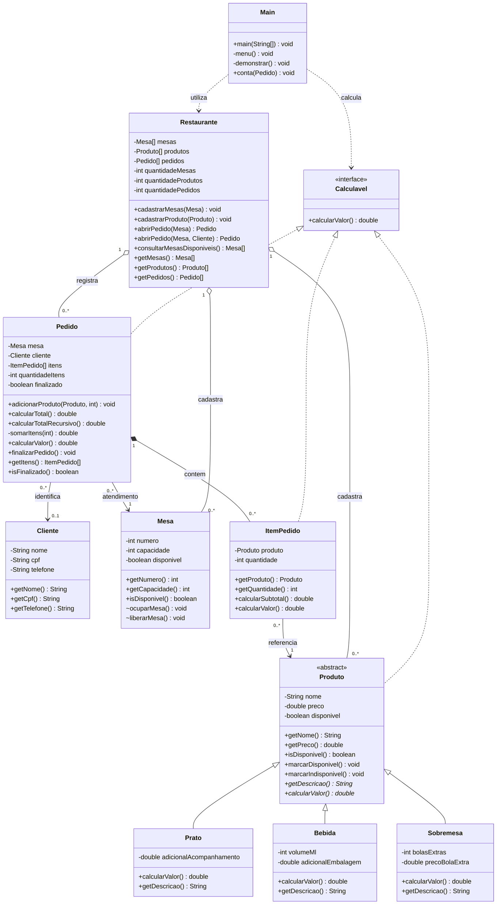

# Diagrama de classes UML

[Versão vetorial ampliável](diagrama-classes.svg) | [Fonte Mermaid](diagrama-classes.mmd)

O losango cheio indica composição: cada item pertence a um pedido. O losango vazio indica agregação de cadastros pelo restaurante. Uma mesa pode estar associada a vários pedidos históricos, mas a regra de negócio permite somente um aberto por vez. O cliente é opcional em cada pedido. `Produto`, `ItemPedido` e `Pedido` realizam `Calculavel`; o cálculo concreto dos produtos vem das subclasses.
